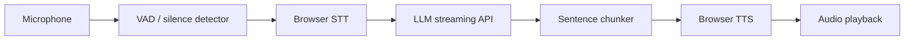

# Voice Agent Stack

A browser-first voice agent demo focused on measurable user-perceived latency. The app captures microphone input, detects end-of-speech with silence heuristics, streams LLM output, chunks the response by sentence, and then speaks the result using browser text-to-speech.

## Demo

Local development URL:

- http://localhost:5174/

This repository does not deploy a remote live URL in this environment.

## Architecture



## Latency definition

Primary metric = elapsed time between the detected end of user speech and the first audible agent audio.

The app records the following timestamps:

- `user_speech_started_at`
- `user_speech_ended_at`
- `end_of_turn_detected_at`
- `stt_started_at`
- `stt_first_result_at`
- `stt_final_at`
- `llm_started_at`
- `llm_first_token_at`
- `llm_finished_at`
- `tts_started_at`
- `tts_first_audio_at`
- `playback_started_at`

Derived metrics:

- EOU latency = `end_of_turn_detected_at - user_speech_ended_at`
- STT latency = `stt_final_at - stt_started_at`
- LLM TTFT = `llm_first_token_at - llm_started_at`
- LLM total = `llm_finished_at - llm_started_at`
- TTS TTFA = `tts_first_audio_at - tts_started_at`
- total user-to-first-audio = `tts_first_audio_at - user_speech_ended_at`

## Baseline and optimization

This project includes the architecture and instrumentation needed for baseline and optimized runs, but only the LLM/SSE microbenchmark is fully populated in this environment.

The baseline path is a blocking pipeline: detect final transcript, wait for the entire LLM response, then generate and play TTS as a single chunk.

The optimized path streams partial LLM output and starts speech synthesis on sentence chunks as soon as a meaningful chunk is available.

## LLM streaming microbenchmark

Measured from the real streaming endpoint (25 interactions per mode):

| Metric    | Baseline median | Optimized median |              Improvement |
| --------- | --------------: | ---------------: | -----------------------: |
| LLM TTFT  |          687 ms |             5 ms |             99.3% faster |
| LLM total |          687 ms |         4,077 ms | slower to finish overall |

This section measures first model token arrival and stream transport behavior. It does not claim to be a complete voice benchmark because it does not include real browser mic capture, STT, TTS, or actual playback timing.

## Full voice benchmark

The assignment requires a full voice metric:

user_speech_end_reference_at → first_agent_audio_playback_at

This is the primary metric for user-perceived latency and it is not yet complete in this repository because no real microphone benchmark has been collected. The application includes a manual browser benchmark workflow for that purpose.

| Metric             |          Baseline median |         Optimized median | Improvement |
| ------------------ | -----------------------: | -----------------------: | ----------: |
| EOU                | pending manual benchmark | pending manual benchmark |     pending |
| STT                | pending manual benchmark | pending manual benchmark |     pending |
| LLM TTFT           | pending manual benchmark | pending manual benchmark |     pending |
| LLM total          | pending manual benchmark | pending manual benchmark |     pending |
| TTS TTFA           | pending manual benchmark | pending manual benchmark |     pending |
| User → first audio | pending manual benchmark | pending manual benchmark |     pending |

| Metric             | Baseline p95 | Optimized p95 |
| ------------------ | -----------: | ------------: |
| User → first audio |      pending |       pending |

The optimization is still valid if the optimized stack begins speaking after the first sentence while generation continues, even if the total answer completion time remains similar. That is why the actual user-to-first-audio metric matters more than whole-response completion time.

## Why it works

The critical path is shortened by eliminating the full-response wait before audio begins. The system starts speaking on semantically complete chunks instead of waiting for the entire answer to finish.

## Trade-offs

- audio quality vs latency
- model quality vs TTFT
- chunk size vs naturalness
- complexity vs maintainability
- provider dependency and cost
- interruption semantics

## Running locally

1. Install dependencies:
   ```bash
   npm install
   ```
2. Create the environment file:
   ```bash
   cp .env.example .env
   ```
3. Start the local stack:
   ```bash
   npm run dev
   ```
4. Open http://localhost:5174/
5. Click Start, allow microphone access, and speak a prompt such as:
   - "What is the capital of France?"
   - "Explain what an API is in one sentence."
   - "Give me three quick tips for learning TypeScript."

## Environment variables

See the `.env.example` file. The required variables are:

- `PORT` – Express server port
- `VOICE_PROVIDER_MODE` – `mock` or `openai`
- `OPENAI_API_KEY` – optional server-side API key
- `OPENAI_MODEL` – default model name
- `OPENAI_BASE_URL` – OpenAI-compatible endpoint
- `VAD_SILENCE_MS` – silence threshold for end-of-turn detection
- `VAD_MIN_SPEECH_MS` – minimum speech duration
- `VAD_MAX_SPEECH_MS` – maximum single-utterance allowance
- `TTS_CHUNK_MIN_CHARS` – minimum text length before chunk playback
- `TTS_CHUNK_MAX_CHARS` – maximum chunk size before split

## Demo instructions

1. Open the app.
2. Click the microphone button.
3. Allow mic permission.
4. Speak naturally.
5. Observe transcript updates and the agent response.
6. Review the latency panel to inspect the stage breakdown.

## Benchmark

The project includes both a streaming benchmark and a manual browser benchmark workflow.

To re-run the LLM streaming benchmark locally:

```bash
npm run dev:server
npx tsx scripts/collect-benchmark.ts
npm run analyze-latency -- data/baseline.json
npm run analyze-latency -- data/optimized.json
```

To run the manual browser voice benchmark:

1. Start the app with `npm run dev`.
2. Open http://localhost:5174/.
3. Click the benchmark mode controls.
4. Click Start Benchmark.
5. Speak the prompt shown on screen.
6. Wait for the response to begin and play.
7. Click Next prompt for the next interaction.
8. Repeat until at least 20 interactions are captured.
9. Click Export JSON to save the results to `data/voice-baseline.json` and `data/voice-optimized.json` or copy them into the repository under the same names.

Manual browser benchmark required. No microphone-derived voice results are claimed yet.

## Limitations

- The browser microphone and speech recognition support differ by browser.
- Real benchmark numbers require a functioning mic and provider credentials.
- Network conditions will materially change the end-to-end metric.
- The repo includes mock provider behavior for local runs when no server credentials are configured.

## Future improvements

- WebRTC stream transport
- server-side VAD / turn detection
- better interruption-aware generation
- regionalized model deployment
- adaptive buffering and model routing
- distributed tracing

## Security

- API keys stay server-side
- `.env` is ignored by Git
- no secrets are committed
- logs avoid exposing credentials

## Files of interest

- `src/App.tsx` – UI and microphone flow
- `src/lib/latency.ts` – latency calculations
- `src/lib/chunker.ts` – sentence chunking
- `server/index.ts` – Express API and provider entrypoint
- `server/providers/llm.ts` – LLM provider abstraction
- `docs/architecture.md` – architecture notes
- `docs/optimization.md` – optimization rationale
- `docs/interview.md` – interview-ready summary
