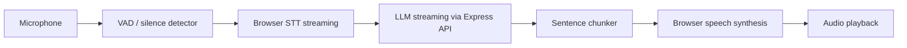

# Architecture Assessment

## Current architecture

This repository was empty when the task started. The implementation now uses a Vite + React frontend and an Express API backend.

## Recommended architecture

## Existing dependencies

- Vite + React + TypeScript frontend
- Express API server for provider isolation
- OpenAI-compatible LLM provider via `OPENAI_API_KEY`
- Browser speech recognition and speech synthesis fallback in demo mode

## Missing components

- Real end-of-turn detector with configurable silence threshold
- Hard production data collection and benchmarking
- Real API keys and provider credentials in `.env`

## Potential bottlenecks

- Browser browser STT is local but constrained by device and browser support
- OpenAI network latency is the dominant remote bottleneck
- TTS is often the last-mile latency limiter if it waits for large sentence chunks

## Risks

- Microphone permission and browser compatibility vary
- Speech synthesis quality varies by browser and device
- Server-side providers can be unstable under poor network conditions

## Primary metric

Primary metric = elapsed time between the detected end of user speech and the first audible agent audio.
